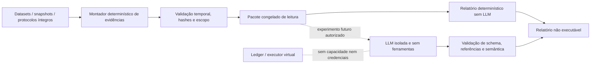

# Estudo proposto · AI Research Council

**Estado: estudo, nenhuma funcionalidade implementada.** Base auditada: `9842db0a3d5b6a52b143be056898f99ded459b56`, branch `main`, sem alterações locais no início. Pesquisa pode sugerir; evidências devem sustentar; o código determinístico valida; o ledger permanece autoridade; IA não controla capital.

## Arquitetura existente

| Subsistema | Fonte e contratos existentes | Estado e confiança | Interface potencial / limite |
| --- | --- | --- | --- |
| Mercado | `worker.collect`, `PublicBybit`, `Snapshot`, `Store`, `canonical_dataset` | snapshots são projeções mutáveis; datasets fechados por SHA-256. Horários da fonte e coleta são distintos. Dados públicos são entrada não confiável. | `Store.load` e dataset fechado verificável; snapshot não é histórico aprovado, e o candle aberto é excluído do dataset. |
| Histórico | `HistoryStore`, `DatasetReader.read` e manifesto aprovado | candles ingeridos e dataset aprovado têm identidade, cobertura e integridade verificadas; janelas UTC `[start,end)`. | reader sem rede; snapshot público não prova disponibilidade point-in-time de metadados históricos. |
| Motor | `engine.indicators`, `ResearchStrategy`, `simulate`, contratos `BacktestConfig`, `InstrumentRules`, `Metrics` | funções determinísticas com Decimal; decisão no fechamento t, fill histórico mais cedo em t+1, custos e política de intrabar; sem short. | Indicadores e métricas calculadas pelo motor; regras de instrumento do snapshot não são regras históricas comprovadas. |
| Research/Arena | `ResearchService`, protocolos/runs imutáveis, `ArenaService`, `ArenaConfig`, `ArenaExperiment` | IDs SHA-256; fingerprint versionado e compatibilidade legada explícita; treino, validação, teste. | Ler resultados e protocolos íntegros; amostras pequenas, dados snooping, custos e escolhas após teste limitam conclusões. Uma leitura em formato projetado deve verificar vínculos. |
| Monitor | `MonitorRuntime`, `monitor_signals`, checkpoints e leases | sinais imutáveis, origin `current` ou `historical_recovered`; validade e fingerprint; recuperação causal limitada. | `current` descreve origem, não liveness; lease não prova continuidade. Sem heartbeat, estado de processo UNKNOWN. |
| Paper | `PaperStore._replay`, bindings, decisões, marcações e evidências | ledger append-only e transações; executor virtual manual existe fora desta proposta, com opt-in explícito; SHA detecta corrupção não coordenada, não é assinatura contra controle total da base. | Projeções read-only e verificadores existentes podem ser estudados; não expor `PaperStore.append`, executor ou métodos que atualizam clock/expiração. |
| Observabilidade | `paper.api.readonly`, `paper.operations`, proxy Next GET | `mode=ro`, `query_only`, transação; alertas derivados, cobertura parcial e limites de 100. | Projeções locais, sem supor verificação global; não tratar HTTP GET como prova suficiente de isolamento do processo. |

Os resultados históricos previamente documentados (38 replays, 14 legados) são evidência de fase anterior, não reexecutados neste estudo.

## Fronteira proposta

**Recomendação:** começar pelo relatório determinístico, sem LLM e sem framework. Um experimento manual com uma LLM, em processo isolado, pode ser proposto depois de um baseline comparativo e autorização específica. Um conselho Bull/Bear/Risk é hipótese para experimento posterior, não arquitetura obrigatória. Papéis podem inicialmente ser seções de um relatório, não processos autônomos. Nenhum papel recebe shell, SQL, HTTP, MCP, executor, credenciais ou acesso direto ao banco; uma futura fronteira fornece apenas cópia mínima verificada. Enforcement deve ser por permissões do processo/SO, mount e egress, não só instrução de prompt ou import Python.

Bull descreve tese e contraprovas; Bear constrói objeções, não short; Risk Auditor identifica incoerências e incertezas, sem validar a segurança sozinho; Report Builder preserva divergência. Um validador determinístico externo verifica referências, janelas, schema e números, mas referência válida não prova causalidade nem verdade semântica. Saída não autoriza plano ou fill.

## Autoridade

| Informação | Autoridade |
| --- | --- |
| Preço, timestamp e candles | snapshot / dataset verificados, com limites de fonte |
| Indicadores, backtest, custo, slippage, drawdown | motor determinístico e protocolo congelado |
| Saldo, PnL paper, posição e equity | ledger reconstruído e marca verificável |
| Hipóteses e contrargumentos | relatório de pesquisa, sempre não confiável até revisão |
| Referências, schema, timestamps e números | validador determinístico; julgamento humano para pertinência |
| Execução e aprovação | fora da capacidade e do escopo da IA |

## Regime descritivo — somente hipótese

SMA20, EMA50, RSI Wilder14 e ATR14 existem. Um eventual classificador poderia definir, antes de testes, janelas explícitas e regras causais para tendência, lateralidade e volatilidade; não há limiares calibrados nesta fase. Proposta: `TREND_UP`, `TREND_DOWN`, `SIDEWAYS`, `HIGH_VOLATILITY`, `INSUFFICIENT_DATA`, `UNKNOWN`; volatilidade pode coexistir com tendência e não deve ser forçada numa categoria exclusiva. Testar warm-up, prefixos invariantes, estabilidade sob pequenas perturbações, mudanças de regime, períodos ausentes e OOS congelado na Arena. Não prevê retorno, não altera estratégia nem autoriza operações.

Contratos propostos: [AI_EVIDENCE_CONTRACTS.md](AI_EVIDENCE_CONTRACTS.md); ameaças: [AI_THREAT_MODEL.md](AI_THREAT_MODEL.md); decisões: [ADR-001](adr/001-framework.md) a [ADR-006](adr/006-relatorios.md).

# Fundação de contexto e mock · 2.3D3A

O subconjunto determinístico está IMPLEMENTED e TESTED em `cryptolab.research.ai_boundary`. O builder aceita bundles v2 verificados e aplica allowlist. O mock stdlib executa em subprocesso supervisionado com gateway independente e orçamento simulado. DEVELOPMENT_MOCK devolve NOT_SANDBOXED. ISOLATED_RESEARCH retorna ISOLATED_RESEARCH_UNAVAILABLE. O gate para D3B é NOT_READY por ausência de fronteiras de SO comprovadas para arquivos, credenciais, rede e recursos.

Contratos, minimização e causalidade em [AI_RESEARCH_CONTEXT.md](AI_RESEARCH_CONTEXT.md). Ambiente Windows, matriz de alternativas e riscos em [AI_RESEARCH_ISOLATION.md](AI_RESEARCH_ISOLATION.md). Limites e contabilidade em [AI_RESEARCH_BUDGET.md](AI_RESEARCH_BUDGET.md). Resultados realmente executados em [VERIFICATION.md](VERIFICATION.md). A investigação e implementação de isolamento forte ficam DEFERRED.
