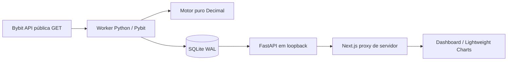

# Arquitetura · CryptoLab

Decisão de 01/11/2026, atualizada na Fase 2.3C2A. Aplicação local Windows, usuário único, somente Bybit Spot. As fases 2.1 e 2.2 acrescentaram histórico, estratégias experimentais e replay offline; as fases 2.3A e 2.3B entregaram a Arena histórica; a 2.3C1 acrescentou a fundação do ledger de carteiras virtuais e a 2.3C2A o monitor informativo de candles.



## Pastas e fronteiras

```text
apps/web/
  src/app/                 App Router, CSS e proxy GET local
  src/components/          shell, dashboard e gráfico
  src/components/ui/       primitives shadcn/ui editáveis
  src/hooks/               polling e tratamento de erros
  src/lib/                 contrato e formatação
backend/
  cryptolab/api.py         consultas locais, validação e estado de segurança
  cryptolab/worker.py      coletor independente, periódico ou --once
  cryptolab/bybit.py       fronteira pública Spot com SDK sem chaves
  cryptolab/engine/        indicadores, contratos, estratégias e replay puros
  cryptolab/research/      protocolo, persistência imutável e CLI/API offline
  cryptolab/arena/         competição histórica sobre ResearchService; CLI/API locais
  cryptolab/paper/         carteiras, ledger e planejador condicional somente de leitura
  cryptolab/monitor/       avaliação informativa de snapshots locais; CLI --once/--loop
  cryptolab/storage.py     transactions, snapshots e datasets
  cryptolab/migrations/    SQL incremental versionado
  tests/                   referência matemática, temporalidade, API e segurança
tests/ui/                  Playwright offline + smoke real opcional
scripts/dev.ps1            inicia processos locais e encerra os que criou
docs/                      decisões, roteiro, design e evidências
data/                      banco local ignorado pelo Git
```

Não reutilizar os projetos legados `cryptoon` e `escryptoon`: já estavam ausentes e com exclusões no Git antes desta tarefa. Essas alterações foram preservadas.

## Contrato de mercado e persistência

Endpoint: `GET /api/v1/market?symbol=BTCUSDT&interval=60`. Somente dois símbolos e intervalos `15`, `60`, `240`, `D`. `GET /health` informa bloqueio de live trading e estado do worker. As novas rotas `/api/v1/history` permitem consultas e enfileiramento/pausa/retomada de pesquisa local. Não há rotas privadas ou de execução de trades.

O worker chama `get_tickers`, `get_kline` e `get_instruments_info` com `category=spot` explícito. Isso é obrigatório: o endpoint de candles usa outro mercado por padrão. A resposta Bybit vem em ordem reversa e é normalizada em ordem crescente. Fechamento é `abertura + intervalo <= relógio da Bybit`. A lista é validada antes de calcular indicadores. [Contrato oficial de candles](https://bybit-exchange.github.io/docs/v5/market/kline).

Cada payload mantém `source_time_ms` (menor horário entre ticker e candles), `fetched_at_ms`, ticker com horário próprio e instrumento com horário próprio. A idade é calculada novamente na API e no navegador. Relógio mais de 5s no futuro ou idade acima de 90s implica obsolescência. Um clique em Atualizar relê o banco, sem transformar dado antigo em novo. Falha no navegador também marca o snapshot mantido como indisponível/obsoleto.

As especificações de instrumento são obtidas da API e não hardcoded. Seus valores não constituem autorização de ordem. [Especificações Bybit](https://bybit-exchange.github.io/docs/v5/market/instrument).

SQLite usa WAL e `busy_timeout` via conexão, migrations sob `BEGIN IMMEDIATE`, commit/rollback e queries parametrizadas. `snapshots` guarda somente a última janela por símbolo/período. `datasets` guarda conteúdo fechado das janelas do dashboard, JSON canônico com versão, mercado, símbolo e período; chave SHA-256. O candle em formação pertence ao snapshot visual, nunca ao conteúdo fechado. Sem retenção automática nesta entrega. Essas janelas de 300 candles não são promovidas a dados históricos aprovados.

Na Fase 2.1, `historical_candles` armazena OHLCV incremental com chave por exchange, mercado, ativo, timeframe e abertura; `historical_datasets` guarda payload e manifesto aprovados, protegidos por triggers. Jobs, runs, páginas e lacunas são rastreáveis em tabelas próprias. Um worker histórico independente usa lease persistido, coleta somente faixas ausentes e aprova apenas cobertura completa. `DatasetReader` verifica hash, manifesto e recorte sem rede. A API continua sem fazer coleta; POSTs de histórico apenas controlam a fila local com validação de origem/intenção. Detalhes, comandos e cobertura real em [HISTORY.md](HISTORY.md).

Na Fase 2.2, `/backtesting` usa proxy local de pesquisa, FastAPI, `DatasetReader` e motor puro, sem Pybit ou rede no replay. `research_protocols` e `research_runs` são tabelas imutáveis; hashes incluem parâmetros, janelas, versão/código, dados de instrumento e resultados. O protocolo é congelado antes do replay; a API limita concorrência e janela. As rotas de pesquisa exigem intenção local e não têm operações de corretora. Detalhes em [BACKTESTING.md](BACKTESTING.md).

Na Fase 2.3A, a Arena histórica cria ou aceita quatro protocolos, executa treino/validação/teste pelo `ResearchService` e compara apenas resultados com premissas equivalentes. Experimento e ranking são imutáveis por SHA-256 e referenciam os resultados existentes. A API compartilha limite de concorrência com backtesting; não coleta dados ou acessa contas. A Fase 2.3B adiciona `/arena` e proxy local restrito; o navegador lê rankings e, sequencialmente, as quatro execuções persistidas para o gráfico. CLI e detalhes em [ARENA.md](ARENA.md).

Na Fase 2.3C1, `paper` adiciona carteiras pausadas por padrão, ledger append-only com transições Decimal e reconstrução verificada. `paper_wallets`, `paper_events` e `paper_heads` usam a migration 005 e transações atômicas; a CLI cria e consulta. Não há worker, API, integração de candles ou execução automática. Detalhes e limites em [PAPER.md](PAPER.md).

Na Fase 2.3C2A, `monitor` lê somente snapshots já coletados, valida frescor, sequência e hash e avalia causalmente condições para posição hipotética. Sinais informativos são imutáveis e idempotentes em `monitor_signals`; o monitor não acessa o ledger paper nem cria fills. Não há serviço em loop nesta fase. Detalhes em [MONITOR.md](MONITOR.md).

## Motor e fórmulas

Valores financeiros são Decimal em contexto local de 34 dígitos; serialização JSON como strings. `float` é permitido somente na apresentação. SMA: média dos últimos N fechamentos. EMA: semente SMA dos primeiros N; alpha=2/(N+1). RSI de Wilder: média inicial de N ganhos/perdas, atualização `(anterior*(N−1)+atual)/N`; mercado constante retorna 50, somente ganhos 100, somente perdas 0. ATR: primeiro TR=high−low; demais TR incluem gaps para fechamento anterior; semente média de N e suavização de Wilder. Warm-up retorna ausente, não zero.

Tendência é descritiva: alta se fechamento>SMA20>EMA50; baixa se fechamento<SMA20<EMA50; neutra nos demais casos. Não equivale a estratégia Trend validada nem gera entrada. Indicadores não usam o candle aberto e têm testes de invariância de prefixo.

## Plano incremental e aceite

| Fase | Entrega | Estado |
| --- | --- | --- |
| 1 | Inspeção, AGENTS, arquitetura e avaliação das referências | Implementada |
| 2 | Design system, dashboard, estados e responsividade | Implementada |
| 3 | Bybit pública, persistência, candles e timestamp real | Implementada |
| 2.1 | Histórico paginado, retomada, arquivo incremental e catálogo aprovado | Implementada; 5.475 candles únicos reais nas faixas documentadas |
| 2.2 | Estratégias e backtesting sobre reader offline aprovado | Implementada; hipóteses experimentais e validação histórica limitada |
| 4 | Sinais operacionais | Planejada; planos nesta entrega pertencem apenas ao replay histórico |
| 2.3A | Backend da Arena histórica com custos equivalentes | Implementado |
| 2.3B | Interface da Arena histórica | Implementada |
| 2.3C1 | Fundação de carteiras e ledger paper | Implementada; sem execução contínua |
| 2.3C2A | Monitor informativo de candles e sinais | Implementado; sem movimentar carteiras |
| 5 | Paper trading contínuo | Planejada |
| 6 | Permissões, elegibilidade, carteira e ordens somente leitura | Planejada; nenhuma credencial solicitada |
| 7 | Verificação progressiva do motor, segurança e UI | Base implementada; expandir nas próximas fases |

### Protocolo de pesquisa · Fase 2.2

Contratos `Strategy`, `SignalPlan`, `BacktestConfig`, `Fill`, `RunManifest` e `Metrics` são implementados no motor puro. Estratégias long-only: Trend (cruzamento de médias), RSI (recuperação após limiar), Breakout (máximo dos N candles anteriores) e Buy & Hold (baseline com mesmos custos). Regras e parâmetros experimentais foram registrados antes dos ensaios. Mack não participa de ranking ou sinais enquanto não especificada e validada.

Manifesto: hash e intervalo do dataset, versão da estratégia, commit do código, dependências fixadas, parâmetros, precisão, política de fills e custos, capital inicial, datas de treino/validação/teste. Não usar relógio atual dentro de um replay. Seed fixa se algum modelo futuro exigir aleatoriedade.

Separação cronológica: escolher parâmetros no treino, comparar na validação e congelar antes do teste. Histórico anterior pode alimentar warm-up causal sem gerar fills no período anterior. Nenhum ajuste após olhar teste; manter testes de prefixo, dados com gaps, amostras adversas e lookahead analysis cruzada. Cada resultado deve indicar amostra e tamanho, sem confundir indicador causal com estratégia rentável.

Decisão no fechamento t; fill mais cedo na abertura t+1 com slippage adverso e taxa por lado. Stop e alvo no mesmo candle: política conservadora (stop primeiro), registrada no manifesto. Gap não preenche a preço impossível. Impor precisões, mínimos e máximos da versão de instrumento usada no replay. Não permitir saldo negativo. Custos configuráveis não são taxas efetivas verificadas da conta.

Métricas: retorno líquido sobre capital inicial, drawdown de equity marcada a mercado, profit factor (lucro bruto/perda bruta absoluta), acerto, expectativa média por trade fechado, quantidade de trades e equity temporal. Divisão por zero gera ausente/infinito representado explicitamente, nunca valor enganoso. Buy & Hold e posições abertas precisam de política comum para marcação/liquidação final com custos.

### Fase 5: Arena e paper

Uma conta virtual independente por estratégia, mesmo capital e mesmas condições. Ledger Decimal e transações atômicas; ordens virtuais com chave de idempotência, sequência do evento e versão de dado. Preenchimentos parciais, custos, saldo, PnL e histórico persistidos. Parada e reinício não duplicam fills. Reconciliação é local, sem conexão a endpoints de trade. Recusar sinais vencidos ou dados antigos. Comparação inclui período fora da amostra destacado e condições da simulação.

### Fase 6: conta privada somente leitura

Não há integração privada nesta entrega. Antes de consultar carteira, validar `readOnly`, permissões efetivas, restrições de IP, validade da chave, tipo de conta e elegibilidade do usuário. Rejeitar configurações ambíguas e credenciais com escrita/saque. A API de informações da chave é uma fonte, não comprovação de elegibilidade regional. [Bybit API Key Information](https://bybit-exchange.github.io/docs/v5/user/apikey-info).

Preferir Windows Credential Manager e segredos apenas em memória do backend; não armazenar em SQLite, frontend ou logs. Expor saldo e ordens por DTOs mínimos e sanitizados. Não supor capacidades de unified account ou stops Spot sem verificar documentação vigente, conta e produto.

### Execução futura: permanece ausente

Requer nova autorização explícita e revisão de arquitetura. Um módulo separado deve controlar: proposta vinculada a snapshot, validade e aprovação humana; nonce/ID idempotente por intenção; precisão e limites; máquina de estados para aceitação, fills parciais, rejeição e cancelamento; stops cuja disponibilidade seja verificada; reconciliação após timeout/reinício; auditoria com retenção e sem segredos; kill switch e exposição máxima. Se a consulta de permissão ou reconciliação falhar, bloquear novas ordens. Aprovação humana nunca é inferida de um sinal. Não conectar Freqtrade live ao app.

## Limites operacionais

Uso privado em loopback, sem autenticação multiusuário; não publicar. API não habilita CORS amplo e valida Host. Proteção adicional e autenticação seriam necessárias antes de qualquer exposição remota. SQLite em OneDrive funciona no ensaio local, mas para coleta contínua mover o banco para disco local não sincronizado por variável de ambiente, igual em API e nos workers. Executar um worker de snapshots por banco; esse coletor original não tem lock de líder. O histórico tem um lease global próprio para serializar CLI/worker histórico, sem bloquear o coletor do dashboard. Backup deve usar mecanismo SQLite consistente, não copiar apenas arquivo `.sqlite3` durante escrita WAL.
