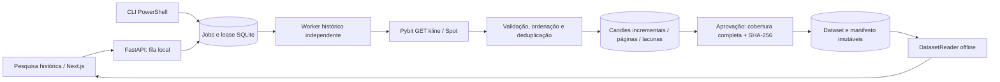

# Fase 2.1 · Motor de dados históricos

Implementação incremental em 01/11/2026. As tabelas, API de mercado, fórmulas e gráficos do dashboard foram preservados. A nova área é `/history`, acessível pelo item Dados históricos. Nenhuma estratégia ou execução de trade foi adicionada.

## Arquitetura e reutilização



Reutilizados: `Candle` e seus validadores Decimal/OHLCV, símbolos e intervalos permitidos, `Store.connect`, migrations transacionais e WAL. O parser de migrations passou a usar `sqlite3.complete_statement`, permitindo triggers com semicolons internos sem introduzir commits implícitos de `executescript`. Migrations existentes continuam idempotentes; a nova é `002_history.sql`. Foreign keys são habilitadas em cada conexão.

`history.storage.HistoryStore` amplia o acesso ao mesmo banco sem tocar nas tabelas `snapshots`, `datasets` e `collection_status`. O worker original continua atualizando o dashboard. O histórico usa cliente SDK e processo próprios, sem bloquear o event loop da API nem executar downloads em requisições HTTP. Locks de escrita existem apenas em transações curtas; rede, backoff e construção do payload canônico ficam fora deles. SQLite WAL permite leitura enquanto outro processo confirma uma página.

## Coleta e retomada

Contrato UTC `[start,end)`. Datas simples representam meia-noite UTC; ISO com horário precisa de offset. Limites devem coincidir com aberturas do timeframe. No máximo 100.000 candles por job. Cada faixa ausente é dividida em janelas de até **1.000** candles esperados. A API recebe início em ms e `end=exclusivo*1000−1`, com `category=spot` e `limit=1000` explícitos. As respostas são ordenadas localmente, independentemente da ordem reversa da Bybit. [Contrato Bybit V5](https://bybit-exchange.github.io/docs/v5/market/kline).

Todos os preços e volumes entram como strings, são validados em Decimal e persistidos como JSON canônico de strings decimais. Timestamps são segundos inteiros UTC, alinhados; o envelope Bybit preserva seu horário em ms. OHLC inválido, volume negativo, não finitos, mercado/símbolo incorretos, timestamp desalinhado ou duplicatas conflitantes recusam a página inteira. Relógio Bybit mais de 5s no futuro também é recusado. Não se exige que um histórico antigo pareça recente.

Duplicatas idênticas são contadas e removidas. Linhas fora da janela são contadas e excluídas, sem ampliar o período pedido. Candles cuja abertura+intervalo ultrapasse o relógio Bybit ficam fora do arquivo. Uma resposta vazia ou curta não aprova cobertura inexistente. Não há candle sintético. Caso haja conflito com um candle já persistido, a transação inteira faz rollback, preservando as páginas válidas anteriores.

Ao iniciar/retomar, o coletor consulta timestamps pela chave composta e deriva somente as faixas faltantes. Não há cursor volátil obrigatório: as linhas confirmadas são o checkpoint. Ele faz uma passagem finita por essas faixas; buracos não resolvidos encerram em `incomplete`, sem loop automático. Retomar explicitamente tenta os buracos novamente. Pedidos equivalentes, mesmo com offsets ISO diferentes, reutilizam o mesmo job por limites UTC. Se concluído, a CLI não cria cliente de rede.

## Estado durável e concorrência

Estados: `queued`, `running`, `paused`, `failed`, `incomplete`, `completed`. Cada execução tem um registro em `historical_runs`, com versão, início, término e erro sanitizado. Uma página gera auditoria com período, horário de fonte/coleta, contagens recebidas, inseridas, duplicadas, abertas e fora da faixa. `historical_gaps` registra as faixas ausentes ao encerrar uma tentativa; cobertura corrente é recalculada diretamente do arquivo. Jobs sobrepostos podem aproveitar candles coletados por outro job.

Um lease global de **120s** serializa backfills do mesmo banco entre CLI e worker. A aquisição usa `BEGIN IMMEDIATE`; o token de posse e a expiração são conferidos antes de cada commit de página. Heartbeats renovam o lease durante espera/retry. Um processo antigo não confirma páginas depois que outro recupera a posse. Uma execução encerrada abruptamente é registrada como interrompida quando seu lease expira e o trabalho é recuperado. Pausa de job em fila é imediata; durante execução, é observada entre operações e em esperas de no máximo 1s. Uma chamada HTTP em andamento pode levar até seu timeout de 6s antes da pausa.

Ctrl+C encerra a tentativa em `paused` e libera o lease normalmente. Queda forçada não desfaz commits anteriores; depois da expiração, os timestamps faltantes determinam o restante. O worker processa um job por vez e consulta a fila a cada 2s. Jobs que falharam ou ficaram incompletos requerem retomada explícita, evitando chamadas repetidas indefinidas.

## Rate limits e falhas

Pacing mínimo de 0,5s antes de cada tentativa. Até quatro tentativas por página para falhas transitórias, com backoff 2s/4s/8s e respeito ao maior prazo de `Retry-After`/reset informado. Cabeçalhos com espera acima de 60s interrompem a tentativa para retomada posterior. O SDK histórico usa uma única tentativa interna e não recebe os códigos de retry automáticos padrão, evitando duplicar espera e contagem.

403 para imediatamente, sem alternar domínio ou contornar bloqueios. A Bybit orienta interromper sessões e aguardar ao menos dez minutos quando o 403 corresponde a excesso de frequência. 403 também pode ter outras causas; o app não presume elegibilidade regional. [Limites oficiais](https://bybit-exchange.github.io/docs/v5/rate-limit), [códigos de erro](https://bybit-exchange.github.io/docs/v5/error).

Erros persistentes fecham a tentativa com código público, preservando progresso. Logs e API não expõem respostas brutas, headers ou configuração privada. Não há credenciais no cliente histórico.

## Armazenamento e aprovação

| Tabela | Função |
| --- | --- |
| `historical_candles` | Chave `(exchange,market,symbol,interval,open_time)`, OHLCV canônico, hora de origem/coleta e run original; sem updates/deletes. |
| `historical_jobs` | Pedido UTC único, estado, pausa, erro e hash aprovado. |
| `historical_lease` | Posse temporária do coletor histórico. |
| `historical_runs` | Tentativas e versão do coletor. |
| `historical_pages` | Auditoria das páginas confirmadas, inclusive vazias. |
| `historical_gaps` | Lacunas por tentativa/job; nunca preenchidas artificialmente. |
| `historical_datasets` | JSON fechado, manifesto, SHA-256 e índices de catálogo; triggers recusam update/delete. |

As consultas de período usam o índice primário composto com faixa em `open_time`. Não importamos snapshots do dashboard para esse arquivo. Os datasets antigos de janelas curtas permanecem com sua função anterior e não são apresentados como aprovados para pesquisa.

Aprovação exige exatamente as aberturas esperadas, ordem crescente, OHLCV válido e somente candles fechados. O conteúdo canônico tem esquema, fonte, mercado, símbolo, timeframe, limites e candles; exclui hora da coleta, job/run, versão do SDK e aprovação. Decimais numericamente iguais recebem a mesma representação sem depender de `Decimal.normalize()` ou do contexto global. SHA-256 é calculado sobre JSON UTF-8, chaves ordenadas e separadores fixos.

O manifesto guarda origem, mercado, ativo, timeframe, limites exclusivos, quantidade, cobertura, lacunas, integridade, esquema, hash, primeiro/último momento de coleta, aprovação e versões do coletor/SDK. A auditoria de runs originais é incluída nos novos manifestos, quando disponível; datasets já aprovados continuam intactos. Os quatro primeiros manifestos reais não foram reescritos após esse campo adicional. Seus runs permanecem rastreáveis pelo banco.

## Contrato para pesquisa

```python
from cryptolab.config import Settings
from cryptolab.history.models import parse_utc
from cryptolab.history.reader import DatasetReader
from cryptolab.history.storage import HistoryStore

store = HistoryStore(Settings.from_env().database_path)
reader = DatasetReader(store)
dataset = reader.read(
    "f3b2e55b1cc373d448efa3676c63064cb482c86be4ebd7442bce573134f972c6",
    parse_utc("2026-09-01"),
    parse_utc("2026-09-01T03:00:00Z"),
)
# dataset.candles: tuple[Candle, ...], valores Decimal, somente fechados
# dataset.manifest: integridade e proveniência
# dataset.reference_hash: SHA-256 do dataset completo
```

O reader confere hash, conteúdo canônico, manifesto, integridade completa e alinhamento antes de retornar. Um recorte mantém o hash de referência completo e informa seus limites; não se apresenta como um novo dataset independente. Não há dependência de Pybit ou chamadas de rede no reader. Sem hash aprovado, não há série liberada ao futuro backtester.

## API e interface

`GET /api/v1/history/coverage` recebe `symbol`, `interval`, `start`, `end`; retorna segmentos e lacunas da faixa. `GET /jobs` e `/jobs/{id}` mostram progresso, runs e gaps; `POST /jobs` enfileira e `POST /jobs/{id}/pause|resume` controla somente o job local. `GET /datasets` lista manifestos; `GET /datasets/{hash}` verifica e pagina OHLCV por `offset` e `limit` (até 1.000), com recorte UTC opcional. Catálogos apresentam os 50 registros mais recentes; IDs conhecidos continuam consultáveis.

Mutações exigem `X-CryptoLab-Research: 1`; o backend mantém Host restrito e não habilita CORS amplo. O proxy Next só permite recursos históricos explícitos, encaminha para backend HTTP de loopback e recusa POST de outra origem. Esse cabeçalho protege a intenção local contra formulários cross-origin, não constitui autenticação multiusuário. As rotas não têm qualquer operação de conta/corretora.

A página reaproveita shell, botão, tokens, tabelas e estados existentes. Campos UTC, limites de faixa, progresso de cobertura, lacunas, pausa/retomada e catálogo têm estados vazios/erro/carregamento. Erros de ação não desaparecem pelo polling de 3s. Verificar e consultar valida hash no backend antes de mostrar manifesto e três candles de prévia. Float é usado apenas em apresentação, incluindo percentuais de cobertura; a série de pesquisa mantém Decimal.

## Evidência real

| Série | Período UTC `[início,fim)` | Candles únicos | Páginas | Lacunas |
| --- | --- | ---: | ---: | ---: |
| BTCUSDT · 1h | 01/09/2026–01/11/2026 | 1.464 | 2 | 0 |
| ETHUSDT · 15m | 01/10/2026–01/11/2026 | 2.976 | 3 | 0 |
| BTCUSDT · 4h | 01/09/2026–01/11/2026 | 366 | 1 | 0 |
| ETHUSDT · 1d | 01/01/2025–01/11/2026 | 669 | 1 | 0 |

Total: **5.475 candles únicos**, cobertura de 100% nas quatro faixas. Hashes:

```text
BTCUSDT 1h  f3b2e55b1cc373d448efa3676c63064cb482c86be4ebd7442bce573134f972c6
ETHUSDT 15m 09b038890de224bceba3e850a3116131c5a9216370213482ef980c58184173c7
BTCUSDT 4h  7af1d5db748235b4f1f12dc609b65ea0050e3a0c49c99914934a0a468673655d
ETHUSDT 1d  786186a7747f4f77d55e5499b21d39a883053a34bae2762eab6073b8ab41ff82
```

O fluxo UI/proxy → API → fila → worker também aprovou BTCUSDT 1h de 01/09 a 02/09/2026 (24 candles) usando **zero páginas de rede novas**, por reutilização do arquivo. Esse quinto dataset tem hash `02314a7a9918eb19c975cdae1b94ead55c784499ed7690c706317f50b0b43cb1` e não aumenta a contagem única.

Consulta offline demonstrada: BTCUSDT 01/09/2026 00:00–03:00 UTC retornou fechamentos `78644.7`, `78404.7` e `78454.4`, mantendo o hash do dataset completo. A repetição do comando original BTCUSDT retornou o mesmo job/hash e manteve duas páginas e uma tentativa, sem baixar outra vez.

## Limitações e pendências

- A cobertura é a das faixas acima; não se afirma que todos os ativos/timeframes ou todo o histórico da corretora estejam carregados.
- Não há preenchimento, inferência de preço ou aprovação parcial. Períodos pré-listagem, futuros ou com candles abertos podem ficar incompletos.
- Correções retroativas do provedor não sobrescrevem dados validados. Processo de reverificação/quarentena e novas gerações de arquivo será necessário se forem identificadas revisões; não foi implementado nesta fase.
- Retenção, compactação e import/export de pacotes portáveis ficam para evolução. `read` exporta consulta JSON e o banco contém o payload exato; backup SQLite consistente preserva datasets. Não copiar apenas o `.sqlite3` durante escrita WAL.
- Leitura/aprovação de até 100.000 candles é em memória, linear no tamanho. Streaming por chunks deve ser avaliado antes de ampliar o limite.
- Catálogos mostram 50 registros. A série OHLCV via HTTP é paginada; o reader Python retorna a série completa ou um recorte.
- Pacing e lease limitam o coletor histórico deste banco; não controlam outros programas que usem o mesmo IP. 403 persistente exige investigação, sem bypass de domínio.
- O banco padrão segue em workspace OneDrive. Configure arquivo em disco local não sincronizado para operação contínua, igual em todos os processos.
- Não há autenticação remota, cronograma automático de grandes backfills, estratégias, métricas da Arena, integração Freqtrade funcional ou execução de trades.

## Arquivos desta fase

Criados: `backend/cryptolab/history/{__init__,models,storage,source,collector,reader,cli,worker,api}.py`; `backend/cryptolab/migrations/002_history.sql`; `backend/tests/test_history.py`; `apps/web/src/app/history/page.tsx`; `apps/web/src/app/api/history/[...path]/route.ts`; `apps/web/src/components/history-research.tsx`; `apps/web/src/lib/history.ts`; `tests/ui/history.spec.ts`; `docs/HISTORY.md`; `docs/PHASE_2_2.md`.

Alterados: `AGENTS.md`, `README.md`, `backend/cryptolab/api.py`, `backend/cryptolab/storage.py`, `backend/tests/test_api_storage.py`, `apps/web/src/components/shell.tsx`, `apps/web/src/app/globals.css`, `playwright.config.ts`, `scripts/dev.ps1`, `docs/ARCHITECTURE.md`, `docs/DESIGN.md`, `docs/VERIFICATION.md`. Sem novas dependências de runtime.
